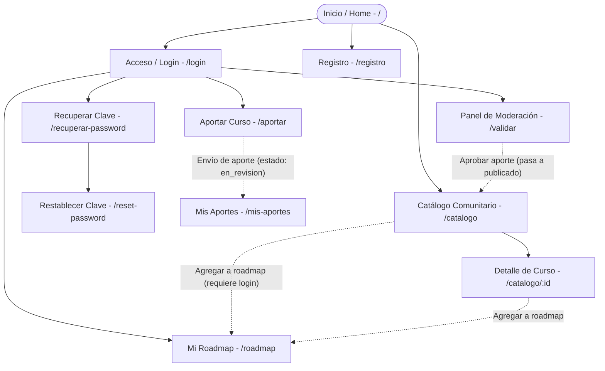
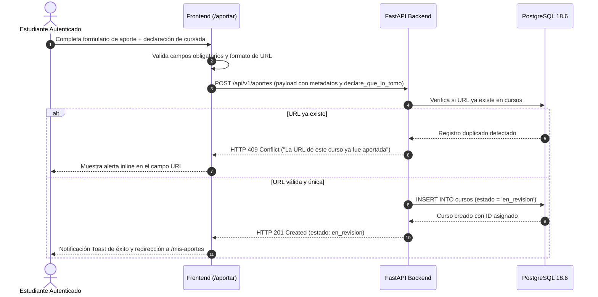
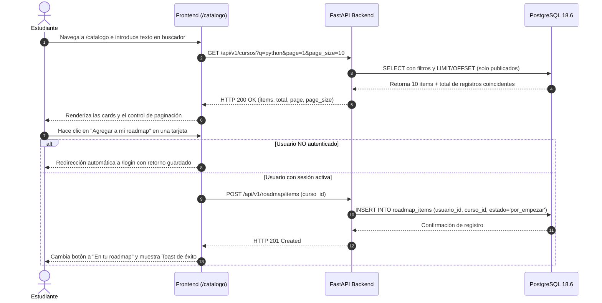
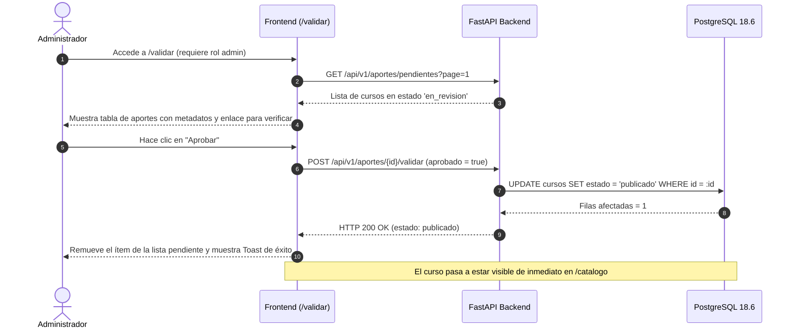

# APPFlow — Mapa del sitio y flujos de usuario — ComunidadCursos

> **Qué es este documento:** define la arquitectura de información, navegación y flujos de interacción de **ComunidadCursos**. Actúa como puente entre los requisitos del PRD y los contratos de datos del BackendSchema.
> **Cuándo está bien:** permite recorrer la totalidad de la experiencia de usuario antes de programar componentes en React; cada pantalla conoce con precisión qué endpoints de la API consume; y no existen rutas huérfanas ni flujos incompletos.

---

## 1. Sitemap (Arquitectura de Navegación)

---

## 2. Tabla de Rutas

| Ruta | Pantalla / Vista | Requiere Autenticación | Rol Permitido | Descripción y Funcionalidad |
|------|------------------|------------------------|---------------|-----------------------------|
| `/` | Inicio (Landing / Home) | No | Público | Presentación de la plataforma, estadísticas comunitarias y accesos directos al catálogo. |
| `/catalogo` | Catálogo Comunitario | No | Público | Explorador paginado de cursos validados con buscador por texto y filtros por categorías. |
| `/catalogo/:id` | Detalle de Curso | No | Público | Ficha técnica completa del curso, enlace al contenido original y acción de agregar al roadmap. |
| `/login` | Iniciar Sesión | No (redirige si ya hay sesión) | Público | Formulario de autenticación con protección contra ataques de fuerza bruta (rate limit). |
| `/registro` | Crear Cuenta | No (redirige si ya hay sesión) | Público | Alta de estudiante con validación de nombre, email y contraseña segura. |
| `/recuperar-password` | Solicitar Recuperación | No | Público | Formulario para solicitar enlace/token de reseteo de contraseña. |
| `/reset-password` | Restablecer Contraseña | No | Público | Definición de nueva contraseña mediante token temporal recibido. |
| `/roadmap` | Mi Roadmap Personal | Sí | `estudiante`, `admin` | Tablero de cursos seleccionados por el usuario, ordenados y con estado de progreso. |
| `/aportar` | Formulario de Aporte | Sí | `estudiante`, `admin` | Carga de nuevo curso gratuito, metadatos y declaración obligatoria de cursada previa. |
| `/mis-aportes` | Mis Aportes Realizados | Sí | `estudiante`, `admin` | Seguimiento del estado de los cursos aportados (`en_revision`, `publicado`, `rechazado`). |
| `/validar` | Panel de Moderación | Sí | `admin` | Bandeja de cursos pendientes para aprobación o rechazo por parte del moderador. |

---

## 3. Fichas de Pantalla

### 3.1 Catálogo Comunitario (`/catalogo`)
- **Objetivo del usuario:** Explorar recursos educativos gratuitos validados, aplicar filtros por disciplina y seleccionar cursos para estudiar.
- **Componentes principales:** Barra superior con menú sándwich y buscador `q`, chips horizontales de categoría, grilla responsive de tarjetas de curso (1 col en mobile, 2 en tablet, 3 en desktop), paginador inferior centrado y empty state con botón para limpiar filtros.
- **Estados de la vista:**
  - `loading`: Visualización de 6 a 9 tarjetas tipo skeleton pulsantes.
  - `ok`: Renderizado de tarjetas con datos reales y barra de paginación activa.
  - `empty`: Mensaje *"No encontramos cursos con los criterios seleccionados"* y botón CTA *"Limpiar filtros"*.
  - `error`: Banner de advertencia con botón *"Reintentar conexión"*.
- **APIs que consume:**
  - `GET /api/v1/cursos?page=1&page_size=10&categoria_id=...&q=...`
  - `GET /api/v1/categorias` (poblar chips de filtro).
- **Navegación:** Clic en tarjeta dirige a `/catalogo/:id`; clic en botón *"Agregar"* llama al endpoint del roadmap y muestra feedback inmediato.

### 3.2 Detalle de Curso (`/catalogo/:id`)
- **Objetivo del usuario:** Evaluar en profundidad los contenidos, vigencia, requisitos y evaluaciones de un curso antes de iniciarlo o guardarlo.
- **Componentes principales:** Encabezado con título y categoría, metadatos estructurados (docente, año, versión), badges de evaluación (cuestionarios, examen, certificado, entidad que avala), declaración de si el autor lo cursó, botón saliente *"Ir al curso externo"* (abre en nueva pestaña) y botón primario *"Agregar a mi roadmap"*.
- **Estados:** `loading` (esqueleto de ficha), `ok`, `error` (404 si el curso no existe o no está publicado).
- **APIs que consume:**
  - `GET /api/v1/cursos/{id}`
  - `POST /api/v1/roadmap/items` (al presionar agregar).

### 3.3 Aportar Curso (`/aportar`)
- **Objetivo del usuario:** Cargar un nuevo curso gratuito encontrado en la web para someterlo a validación comunitaria.
- **Componentes principales:** Formulario vertical con validaciones en tiempo real:
  - Input URL activa (validación de formato y verificación previa de duplicado).
  - Título y tema.
  - Selector de categoría (lista cerrada).
  - Año de edición y versión.
  - Docentes o disertantes.
  - Switches o checkboxes para: ¿Tiene cuestionarios?, ¿Requiere examen?, ¿Extiende certificado?, ¿Aval organizacional? (nombre opcional).
  - **Declaración jurada obligatoria:** Checkbox / Radio *"Declaro que cursé este contenido"* (Sí / No).
  - Botón primario *"Enviar a revisión"*.
- **Estados:** `default`, `submitting` (botón con spinner y campos bloqueados), `error` (mensajes inline accesibles), `success` (toast y redirección).
- **APIs que consume:**
  - `GET /api/v1/categorias`
  - `POST /api/v1/aportes` (retorna HTTP 201 con estado `en_revision`).

### 3.4 Mi Roadmap (`/roadmap`)
- **Objetivo del usuario:** Administrar los cursos guardados, planificar el orden en que se van a realizar y registrar el avance académico.
- **Componentes principales:** Barra de resumen de progreso (ej. "2 completados de 5 cursos"), listado paginado de items de roadmap, selector de estado por curso (`por_empezar`, `en_progreso`, `completado`), controles de subida/bajada de orden y botón para quitar de la ruta.
- **Estados:**
  - `ok`: Lista de cursos ordenados con sus badges de estado interactivos.
  - `empty`: Mensaje ilustrado *"Tu roadmap aún no tiene cursos"* con botón CTA *"Explorar catálogo"*.
- **APIs que consume:**
  - `GET /api/v1/roadmap?page=1&page_size=10`
  - `PATCH /api/v1/roadmap/items/{id}` (actualizar orden o estado de avance).
  - `DELETE /api/v1/roadmap/items/{id}` (eliminar de la ruta personal).

### 3.5 Panel de Moderación (`/validar`)
- **Objetivo del moderador:** Revisar los cursos aportados por la comunidad y asegurar que los enlaces funcionen y el contenido sea gratuito y legítimo.
- **Componentes principales:** Bandeja paginada de aportes con estado `en_revision`. Cada ítem permite ver la URL para probarla, inspeccionar los datos aportados y accionar con dos botones: *"Aprobar"* (verde) o *"Rechazar"* (rojo con modal para ingresar motivo opcional).
- **APIs que consume:**
  - `GET /api/v1/aportes/pendientes?page=1&page_size=10`
  - `POST /api/v1/aportes/{id}/validar` (`{ "aprobado": true/false }`).

---

## 4. Flujos de Usuario Principales (End-to-End)

### Flujo 1 — Aportar un curso al catálogo (P0)

### Flujo 2 — Descubrir un curso y sumarlo al Roadmap personal (P0)

### Flujo 3 — Moderación y Aprobación de Aportes por Administrador (P0)

### Flujo 4 — Recuperación de Contraseña mediante Token (P1)

1. El usuario accede a `/recuperar-password` e introduce su correo electrónico registrado.
2. El frontend envía `POST /api/v1/auth/recuperar-password`.
3. El backend verifica la existencia del usuario, genera un token criptográfico seguro con vencimiento (15 minutos) y lo almacena asociado al usuario.
4. En entorno local/desarrollo, el token se emite en logs para simular el enlace que recibiría por correo: `/reset-password?token=XYZ123`.
5. El usuario ingresa a `/reset-password?token=XYZ123` e introduce su nueva contraseña.
6. El frontend envía `POST /api/v1/auth/reset-password` con el token y la nueva clave.
7. El backend valida el token, encripta la nueva clave con `bcrypt`, actualiza la base de datos e invalida el token.
8. Se notifica al usuario y se lo redirige a `/login`.

---

## 5. Gestión de Estados Globales de la Aplicación

| Escenario | Comportamiento del Frontend | Manejo en la API |
|-----------|-----------------------------|------------------|
| **Intento de acceso a ruta protegida sin sesión** | Redirección inmediata a `/login?redirect=/ruta-original`. Tras autenticarse correctamente, el usuario regresa a la ruta que intentaba consultar. | Respuestas `401 Unauthorized` ante peticiones sin token válido. |
| **Sesión expirada o token JWT inválido** | Cierre automático de sesión en el cliente, limpieza de almacenamiento local y despliegue de Toast informativo: *"Tu sesión expiró. Por favor ingresá nuevamente"*. | Respuestas HTTP `401 Unauthorized`. |
| **Límite de tasa excedido en login (Rate Limit)** | Bloqueo temporal del botón de ingreso, contador regresivo de espera y mensaje de advertencia: *"Demasiados intentos fallidos. Esperá 1 minuto antes de volver a intentar"*. | HTTP `429 Too Many Requests` con cabecera `Retry-After: 60`. |
| **Caída de conexión o error del servidor (500)** | Visualización de banner superior de advertencia no bloqueante con opción de reintentar la solicitud. | Registro de la excepción en logs del backend sin filtrar detalles sensibles al cliente. |

---

**Referencias:**
- Nielsen Norman Group — Information Architecture vs. Sitemaps: https://www.nngroup.com/articles/information-architecture-sitemaps/
- Nielsen Norman Group — User Journeys vs. User Flows: https://www.nngroup.com/articles/user-journeys-vs-user-flows/
