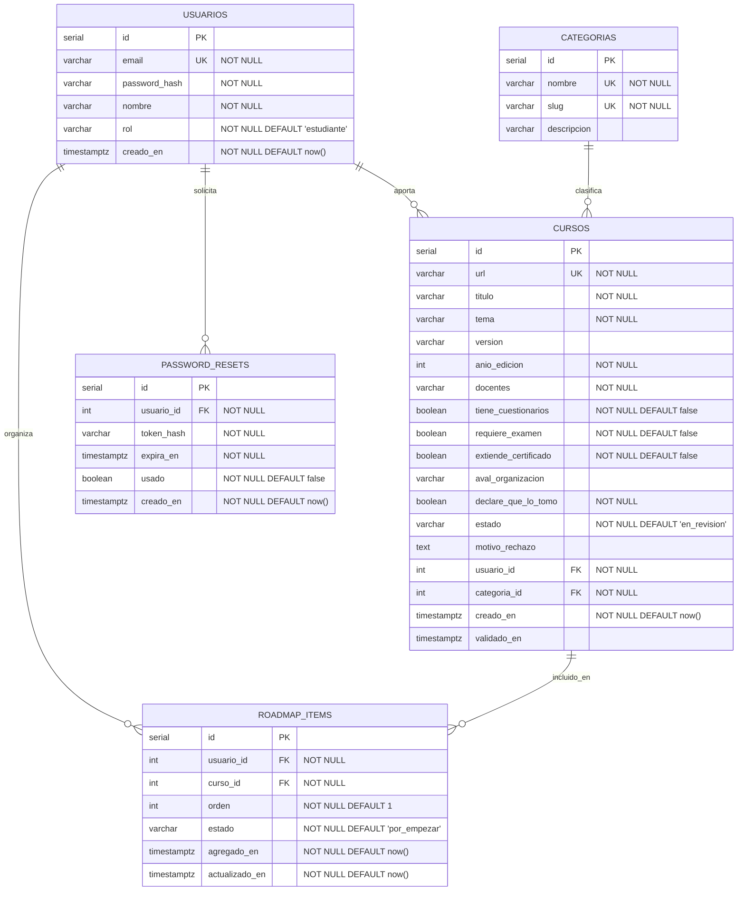
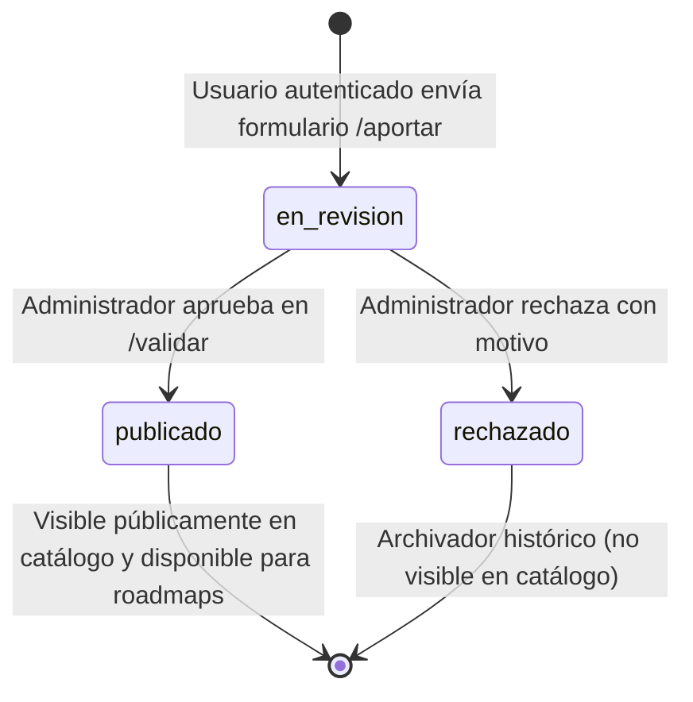

# BackendSchema — Esquema de base de datos y APIs REST — ComunidadCursos

> **Qué es este documento:** define el contrato de datos del backend para **ComunidadCursos**. Especifica el modelo relacional físico en PostgreSQL 18.6 (diagrama entidad-relación, tablas, constraints e índices), los estados del ciclo de vida de los cursos y la superficie completa de endpoints REST en FastAPI.
> **Cuándo está bien:** permite inicializar la base de datos y escribir las migraciones o modelos de SQLAlchemy sin dudas sobre nombres o tipos; toda pantalla del APPFlow tiene sus endpoints correspondientes detallados con códigos de estado HTTP; y la regla obligatoria de paginación está modelada tanto en esquema como en contrato de API.

---

## 1. Modelo de Datos (PostgreSQL 18.6)

### 1.1 Diagrama Entidad-Relación (Mermaid)



---

### 1.2 Definición de Tablas y Restricciones

#### Tabla: `usuarios`
Almacena las cuentas de acceso con credenciales protegidas y roles de autorización.

| Columna | Tipo de Dato | Constraints | Descripción |
|---------|--------------|-------------|-------------|
| `id` | `SERIAL` | `PRIMARY KEY` | Identificador único secuencial. |
| `email` | `VARCHAR(255)` | `NOT NULL, UNIQUE` | Correo electrónico de inicio de sesión (indexado). |
| `password_hash` | `VARCHAR(255)` | `NOT NULL` | Hash seguro de contraseña mediante `bcrypt`. |
| `nombre` | `VARCHAR(100)` | `NOT NULL` | Nombre o alias visible en la comunidad. |
| `rol` | `VARCHAR(20)` | `NOT NULL, CHECK (rol IN ('estudiante', 'admin')) DEFAULT 'estudiante'` | Control de acceso basado en roles (RBAC). |
| `creado_en` | `TIMESTAMPTZ` | `NOT NULL, DEFAULT CURRENT_TIMESTAMP` | Fecha y hora UTC de alta del registro. |

- **Índices:**
  - `idx_usuarios_email`: B-Tree sobre `email` para autenticación en $O(1)$.

---

#### Tabla: `categorias`
Catálogo cerrado de disciplinas formativas para estructurar filtros y aportes.

| Columna | Tipo de Dato | Constraints | Descripción |
|---------|--------------|-------------|-------------|
| `id` | `SERIAL` | `PRIMARY KEY` | Identificador único. |
| `nombre` | `VARCHAR(80)` | `NOT NULL, UNIQUE` | Nombre visible (ej. *"Programación"*, *"Bases de Datos"*). |
| `slug` | `VARCHAR(80)` | `NOT NULL, UNIQUE` | Identificador URL-friendly (ej. `bases-de-datos`). |
| `descripcion` | `VARCHAR(255)` | `NULL` | Breve alcance temático de la categoría. |

---

#### Tabla: `cursos`
Almacena todos los cursos aportados por los estudiantes y supervisados por moderadores.

| Columna | Tipo de Dato | Constraints | Descripción |
|---------|--------------|-------------|-------------|
| `id` | `SERIAL` | `PRIMARY KEY` | Identificador único del curso. |
| `url` | `VARCHAR(2048)` | `NOT NULL, UNIQUE` | Enlace web activo al material externo (evita duplicados). |
| `titulo` | `VARCHAR(200)` | `NOT NULL` | Título descriptivo del contenido formativo. |
| `tema` | `VARCHAR(150)` | `NOT NULL` | Temática puntual (ej. *"SQL Avanzado e Índices"*). |
| `version` | `VARCHAR(50)` | `NULL` | Versión del software o curso (ej. *"Postgres 17/18"*). |
| `anio_edicion` | `INTEGER` | `NOT NULL, CHECK (anio_edicion >= 2000 AND anio_edicion <= 2030)` | Año de publicación original. |
| `docentes` | `VARCHAR(255)` | `NOT NULL` | Nombre de profesores, disertantes o institución autora. |
| `tiene_cuestionarios` | `BOOLEAN` | `NOT NULL, DEFAULT FALSE` | Flag de autoevaluaciones intermedias. |
| `requiere_examen` | `BOOLEAN` | `NOT NULL, DEFAULT FALSE` | Flag de examen final obligatorio. |
| `extiende_certificado` | `BOOLEAN` | `NOT NULL, DEFAULT FALSE` | Flag de emisión de certificado por el proveedor. |
| `aval_organizacion` | `VARCHAR(150)` | `NULL` | Nombre de la entidad acreditadora (ej. *"Linux Foundation"*). |
| `declare_que_lo_tomo` | `BOOLEAN` | `NOT NULL` | Declaración jurada de si el aportante realizó la cursada. |
| `estado` | `VARCHAR(20)` | `NOT NULL, CHECK (estado IN ('en_revision', 'publicado', 'rechazado')) DEFAULT 'en_revision'` | Ciclo de vida del curso. |
| `motivo_rechazo` | `TEXT` | `NULL` | Justificación administrativa si fue rechazado. |
| `usuario_id` | `INTEGER` | `NOT NULL, REFERENCES usuarios(id) ON DELETE RESTRICT` | Usuario aportante. |
| `categoria_id` | `INTEGER` | `NOT NULL, REFERENCES categorias(id) ON DELETE RESTRICT` | Categoría temática asignada. |
| `creado_en` | `TIMESTAMPTZ` | `NOT NULL, DEFAULT CURRENT_TIMESTAMP` | Fecha de carga del aporte. |
| `validado_en` | `TIMESTAMPTZ` | `NULL` | Fecha de moderación por parte del administrador. |

- **Índices:**
  - `idx_cursos_estado_categoria`: Compuesto sobre `(estado, categoria_id)` para acelerar consultas paginadas del catálogo público.
  - `idx_cursos_titulo_tema`: B-Tree (o Gin Trigram) sobre `titulo` y `tema` para búsquedas de texto ágiles.
  - `idx_cursos_usuario_id`: B-Tree sobre `usuario_id` para listar aportes propios en `/mis-aportes`.

---

#### Tabla: `roadmap_items`
Tabla asociativa que vincula usuarios con cursos publicados para estructurar sus itinerarios de estudio.

| Columna | Tipo de Dato | Constraints | Descripción |
|---------|--------------|-------------|-------------|
| `id` | `SERIAL` | `PRIMARY KEY` | Identificador único del ítem. |
| `usuario_id` | `INTEGER` | `NOT NULL, REFERENCES usuarios(id) ON DELETE CASCADE` | Estudiante titular del roadmap. |
| `curso_id` | `INTEGER` | `NOT NULL, REFERENCES cursos(id) ON DELETE RESTRICT` | Curso guardado en el roadmap. |
| `orden` | `INTEGER` | `NOT NULL, DEFAULT 1` | Posición secuencial en el itinerario de estudio. |
| `estado` | `VARCHAR(20)` | `NOT NULL, CHECK (estado IN ('por_empezar', 'en_progreso', 'completado')) DEFAULT 'por_empezar'` | Progreso del estudiante en este curso. |
| `agregado_en` | `TIMESTAMPTZ` | `NOT NULL, DEFAULT CURRENT_TIMESTAMP` | Fecha de incorporación a la ruta. |
| `actualizado_en`| `TIMESTAMPTZ` | `NOT NULL, DEFAULT CURRENT_TIMESTAMP` | Última actualización de estado o posición. |

- **Constraints adicionales:**
  - `UNIQUE (usuario_id, curso_id)`: Un estudiante no puede añadir el mismo curso dos veces a su roadmap.
- **Índices:**
  - `idx_roadmap_usuario_orden`: Compuesto sobre `(usuario_id, orden)` para recuperar el roadmap ordenado en tiempo constante.

---

#### Tabla: `password_resets`
Control de seguridad para tokens efímeros de recuperación de contraseña.

| Columna | Tipo de Dato | Constraints | Descripción |
|---------|--------------|-------------|-------------|
| `id` | `SERIAL` | `PRIMARY KEY` | Identificador del registro. |
| `usuario_id` | `INTEGER` | `NOT NULL, REFERENCES usuarios(id) ON DELETE CASCADE` | Usuario que solicitó la recuperación. |
| `token_hash` | `VARCHAR(255)` | `NOT NULL, UNIQUE` | Hash SHA-256 del token enviado al usuario. |
| `expira_en` | `TIMESTAMPTZ` | `NOT NULL` | Límite temporal de vigencia (ej. 15 minutos). |
| `usado` | `BOOLEAN` | `NOT NULL, DEFAULT FALSE` | Invalida el token tras su primer uso exitoso. |
| `creado_en` | `TIMESTAMPTZ` | `NOT NULL, DEFAULT CURRENT_TIMESTAMP` | Momento de solicitud. |

---

## 2. Estados del Ciclo de Vida del Curso



| Estado | Quién tiene visibilidad | Acciones permitidas |
|--------|-------------------------|---------------------|
| `en_revision` | Usuario autor (en `/mis-aportes`) y Moderadores con rol `admin` (en `/validar`). | El administrador puede probar el enlace, evaluar datos y accionar **Aprobar** o **Rechazar**. |
| `publicado` | Todo el público visitante y usuarios autenticados (en `/catalogo`). | Se puede consultar ficha técnica y agregarlo al roadmap personal. |
| `rechazado` | Usuario autor y Administrador. | Permite consultar el motivo del rechazo; no se muestra en el catálogo comunitario. |

---

## 3. Contratos de API REST (FastAPI)

- **Prefijo base global:** `/api/v1`
- **Paginación uniforme:** Parámetros `page` (entero $\ge 1$, default 1) y `page_size` (entero de 1 a 50, default 10).
- **Estructura de respuesta paginada:**
  ```json
  {
    "items": [...],
    "total": 42,
    "page": 1,
    "page_size": 10
  }
  ```
- **Estructura de error unificada:**
  ```json
  {
    "error": {
      "code": "VALIDATION_ERROR",
      "message": "Parámetros de solicitud no válidos",
      "details": [{ "field": "url", "issue": "URL inválida o inaccesible" }]
    }
  }
  ```

---

### 3.1 Módulo: Autenticación y Seguridad (`/auth`)

| Método | Endpoint | Auth | Query / Payload | Respuestas HTTP |
|--------|----------|------|-----------------|-----------------|
| `POST` | `/api/v1/auth/registro` | Pública | `{ "email": "...", "password": "...", "nombre": "..." }` | `201 Created` (datos básicos sin password)<br>`409 Conflict` (email ya registrado)<br>`422 Unprocessable Entity` |
| `POST` | `/api/v1/auth/login` | Pública *(Rate Limited: 5/min)* | `{ "email": "...", "password": "...", "grant_type": "password" }` | `200 OK` `{ "access_token": "...", "token_type": "bearer", "user": {...} }`<br>`401 Unauthorized` (credenciales inválidas)<br>`429 Too Many Requests` |
| `POST` | `/api/v1/auth/logout` | Bearer Token | Ninguno | `204 No Content` |
| `POST` | `/api/v1/auth/recuperar-password` | Pública | `{ "email": "..." }` | `200 OK` `{ "message": "Si el email existe, se emitió el token de recuperación" }` |
| `POST` | `/api/v1/auth/reset-password` | Pública | `{ "token": "...", "nueva_password": "..." }` | `200 OK` `{ "message": "Contraseña actualizada correctamente" }`<br>`400 Bad Request` (token vencido o usado) |

---

### 3.2 Módulo: Catálogo de Cursos (`/cursos`)

| Método | Endpoint | Auth | Query Parameters | Respuestas HTTP |
|--------|----------|------|------------------|-----------------|
| `GET` | `/api/v1/cursos` | Pública | `page=1`<br>`page_size=10`<br>`categoria_id=2` *(opcional)*<br>`q=python` *(opcional)* | `200 OK` (objeto con `items` publicados y metadatos de paginación)<br>`422 Unprocessable Entity` |
| `GET` | `/api/v1/cursos/{id}` | Pública | Ninguno | `200 OK` (detalle completo del curso con badges y datos del aportante)<br>`404 Not Found` |

---

### 3.3 Módulo: Aportes y Moderación (`/aportes`)

| Método | Endpoint | Auth | Request Payload | Respuestas HTTP |
|--------|----------|------|-----------------|-----------------|
| `POST` | `/api/v1/aportes` | Bearer Token (`estudiante`, `admin`) | `{ "url": "...", "titulo": "...", "tema": "...", "categoria_id": 1, "version": "...", "anio_edicion": 2025, "docentes": "...", "tiene_cuestionarios": true, "requiere_examen": false, "extiende_certificado": true, "aval_organizacion": "...", "declare_que_lo_tomo": true }` | `201 Created` (objeto curso con estado `en_revision`)<br>`409 Conflict` (URL duplicada)<br>`422 Unprocessable Entity` |
| `GET` | `/api/v1/aportes/mis-aportes` | Bearer Token | `page=1`, `page_size=10` | `200 OK` (listado paginado de cursos cargados por el usuario actual) |
| `GET` | `/api/v1/aportes/pendientes` | Bearer Token *(Rol `admin`)* | `page=1`, `page_size=10` | `200 OK` (listado paginado de cursos con estado `en_revision`)<br>`403 Forbidden` (no admin) |
| `POST` | `/api/v1/aportes/{id}/validar` | Bearer Token *(Rol `admin`)* | `{ "aprobado": true, "motivo_rechazo": null }` | `200 OK` (curso actualizado a `publicado` o `rechazado`)<br>`403 Forbidden`<br>`404 Not Found` |

---

### 3.4 Módulo: Roadmap Personal (`/roadmap`)

| Método | Endpoint | Auth | Payload / Query | Respuestas HTTP |
|--------|----------|------|-----------------|-----------------|
| `GET` | `/api/v1/roadmap` | Bearer Token | `page=1`, `page_size=10` | `200 OK` (ítems del roadmap del usuario paginados y ordenados secuencialmente) |
| `POST` | `/api/v1/roadmap/items` | Bearer Token | `{ "curso_id": 12, "orden": 3 }` | `201 Created`<br>`409 Conflict` (curso ya agregado al roadmap)<br>`400 Bad Request` (curso no existe o no está publicado) |
| `PATCH` | `/api/v1/roadmap/items/{id}` | Bearer Token | `{ "orden": 2, "estado": "en_progreso" }` | `200 OK` (ítem actualizado)<br>`404 Not Found`<br>`422 Unprocessable Entity` |
| `DELETE` | `/api/v1/roadmap/items/{id}` | Bearer Token | Ninguno | `204 No Content`<br>`404 Not Found` |

---

### 3.5 Módulo: Categorías (`/categorias`)

| Método | Endpoint | Auth | Query Parameters | Respuestas HTTP |
|--------|----------|------|------------------|-----------------|
| `GET` | `/api/v1/categorias` | Pública | Ninguno | `200 OK` (lista completa de categorías para poblar filtros y selectores) |

---

## 4. Decisiones de Diseño del Esquema Relacional

| Decisión de Diseño | Alternativas Consideradas | Justificación Técnica |
|--------------------|---------------------------|-----------------------|
| Categorías como tabla relacional independiente con clave foránea | Usar tipo `ENUM` nativo de PostgreSQL | Una tabla permite que en el futuro se agreguen nuevas categorías o se actualicen descripciones sin requerir sentencias DDL complejas (`ALTER TYPE`). |
| Campo `url` con `VARCHAR(2048)` y restricción `UNIQUE` | Permitir URLs duplicadas distinguidas por aportante | La restricción única a nivel motor evita el spam y la fragmentación de revisiones sobre un mismo recurso educativo. |
| Tabla asociativa `roadmap_items` con clave primaria subrogada `id` | Clave primaria compuesta `(usuario_id, curso_id)` | Una clave primaria simple `id` simplifica la manipulación individual de ítems (modificar orden, estado o eliminar) desde endpoints REST estilo `/roadmap/items/{id}`. |
| Flags de metadatos (cuestionarios, certificado, etc.) como columnas booleanas | Almacenar atributos en una columna `JSONB` | Las columnas booleanas con valores por defecto ocupan 1 byte por fila, son indexables directamente y permiten queries SQL de filtrado simples sin sobrecarga de serialización JSON. |

---

**Referencias:**
- Mermaid — Entity Relationship Diagrams Syntax: https://mermaid.js.org/syntax/entityRelationshipDiagram.html
- PostgreSQL 18 Documentation — Data Types, Constraints and Indexes: https://www.postgresql.org/docs/current/ddl.html
