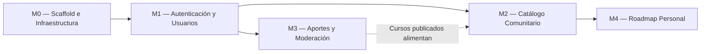

# Implementation Plan — ComunidadCursos

> **Qué es este documento:** define el plan de trabajo y orden constructivo para el desarrollo del MVP de **ComunidadCursos** en la **Instancia B**. Agrupa las tareas por módulos según dependencias lógicas, asigna estimaciones y establece la Definición de Hecho (*Definition of Done*) para cada ítem.
> **Cuándo está bien:** cada tarea posee un criterio de aceptación medible y comprobable sin ambigüedades; el orden de ejecución respeta las dependencias técnicas reales; y cualquier evaluador puede responder objetivamente con un "sí" o "no" si una funcionalidad se encuentra operativa.

---

## 1. Criterio de Aceptación del MVP (Historias P0)

El MVP de la **Instancia B** se considerará formalmente **hecho y aprobado** cuando, en una computadora limpia con Docker instalado, se ejecuten las siguientes instrucciones del README:

```bash
git clone https://github.com/lauty04ARG/Actividad-individual.git
cd Actividad-individual
docker compose up
```

Y sea posible recorrer de punta a punta desde el navegador web (`http://localhost:5173`) las **5 Historias de Usuario P0** del PRD sin errores en consola ni en backend:

1. **US-001 (Catálogo Comunitario):** Explorar el catálogo paginado de cursos validados, filtrar por categoría y realizar búsquedas de texto.
2. **US-002 (Autenticación y Seguridad):** Registrar un nuevo usuario, iniciar sesión obteniendo token JWT, verificar contraseñas hasheadas con bcrypt y comprobar que el login bloquea con HTTP `429` ante más de 5 intentos fallidos consecutivos en 1 minuto.
3. **US-003 (Aporte de Cursos):** Cargar un nuevo curso gratuito completando los metadatos requeridos, marcar la declaración jurada de cursada previa y comprobar que se guarda en estado `en_revision` impidiendo URLs duplicadas.
4. **US-004 (Moderación de Aportes):** Acceder con usuario administrador a `/validar`, aprobar un aporte pendiente y constatar que aparece de inmediato disponible en el catálogo público comunitario.
5. **US-005 (Roadmap Personal):** Agregar un curso publicado al roadmap personal del estudiante, visualizarlo en `/roadmap`, cambiar su estado de avance (`por_empezar` → `en_progreso` → `completado`) y quitarlo de la lista.

---

## 2. Módulos y Grafo de Dependencias



- **M0 es prerequisito absoluto:** No se puede programar lógica sin contenedores ni estructura de carpetas.
- **M1 habilita el control de acceso:** Los aportes y el roadmap exigen conocer la identidad y rol del usuario (`estudiante` o `admin`).
- **M2 y M3 pueden desarrollarse en paralelo:** Ambos operan sobre la entidad cursos pero con diferentes responsabilidades (lectura comunitaria vs. carga y moderación).
- **M4 corona el flujo de valor:** Requiere que existan cursos publicados disponibles para ser agregados al itinerario del usuario.

---

## 3. Detalle por Módulos y Tareas

### M0 — Scaffold e Infraestructura de Desarrollo

| # | Tarea | Definición de Hecho (DoD) Verificable | Estimación |
|---|-------|---------------------------------------|------------|
| **0.1** | Creación del árbol de directorios Screaming Architecture | Las carpetas por dominio (`courses/`, `roadmaps/`, `auth/`, etc.) existen en `backend/` y `frontend/` respetando el TRD §3.2. | 30 min |
| **0.2** | Orquestación Docker Compose dev | `docker compose up postgres` inicia PostgreSQL 18.6 en el puerto 5432 y persiste datos en el volumen `postgres_data`. | 45 min |
| **0.3** | Inicialización de Backend FastAPI con uv | Contenedor backend levanta con hot-reload; `curl http://localhost:8000/health` responde `{ "status": "ok" }`. | 1 h |
| **0.4** | Inicialización de Frontend Vite + React 19 con pnpm | Contenedor frontend levanta; al acceder a `http://localhost:5173` se renderiza el Shell básico con Header sticky y menú sándwich. | 1 h |

---

### M1 — Autenticación, Seguridad y Roles (US-002, US-006)

| # | Tarea | Definición de Hecho (DoD) Verificable | Estimación |
|---|-------|---------------------------------------|------------|
| **1.1** | Modelo `usuarios` y conexión SQLAlchemy async | Tabla creada en PostgreSQL 18.6 con tipos, índices y constraints de `BackendSchema §1.2`. | 1 h |
| **1.2** | Endpoints de Registro y Login con Bcrypt y JWT | `POST /api/v1/auth/registro` crea usuario y `POST /api/v1/auth/login` devuelve token bearer válido. | 2 h |
| **1.3** | Middleware de Rate Limiting en Login | Al enviar más de 5 peticiones fallidas por minuto desde la misma IP, la API responde `HTTP 429 Too Many Requests`. | 1 h |
| **1.4** | Formularios de Auth en Frontend y Estado de Sesión | Vistas `/login` y `/registro` conectadas; almacenamiento seguro del token en memoria/contexto y redirección protegida. | 2 h |
| **1.5** | Flujo de recuperación de clave (P1) | `POST /api/v1/auth/recuperar-password` emite token seguro y `/reset-password` permite actualizar la clave. | 1 h 30 min |

---

### M2 — Catálogo Comunitario Paginado (US-001, US-007)

| # | Tarea | Definición de Hecho (DoD) Verificable | Estimación |
|---|-------|---------------------------------------|------------|
| **2.1** | Seed de datos iniciales (categorías y cursos) | Script SQL o comando que inserta 5 categorías maestras y al menos 15 cursos publicados para pruebas inmediatas. | 45 min |
| **2.2** | Endpoint `GET /api/v1/cursos` paginado y con filtros | Consulta con parámetros `page`, `page_size`, `categoria_id` y `q` retorna `{ "items": [...], "total": N, ... }`. | 2 h |
| **2.3** | Componente de grilla responsive y Cards de curso | Grilla mobile-first (1 col < 768px, 2 col en tablet, 3 col en desktop) con badges de certificado/examen e indicador de cursada. | 2 h 30 min |
| **2.4** | Control de Paginación en UI | Barra de paginación estilo Google con botones Anterior/Siguiente y números de página funcionales. | 1 h 30 min |
| **2.5** | Pantalla de Detalle de Curso `/catalogo/:id` | Muestra toda la ficha técnica y botón hacia la URL externa activa. | 1 h |

---

### M3 — Aportes y Moderación de Cursos (US-003, US-004)

| # | Tarea | Definición de Hecho (DoD) Verificable | Estimación |
|---|-------|---------------------------------------|------------|
| **3.1** | Endpoint `POST /api/v1/aportes` con validación estricta | Inserta curso en estado `en_revision` requiriendo `declare_que_lo_tomo`; rechaza URLs duplicadas con `HTTP 409 Conflict`. | 2 h |
| **3.2** | Formulario en Frontend `/aportar` con validación inline | Formulario completo con los 12 metadatos, validación de URL y checkbox obligatorio de declaración de cursada. | 2 h 30 min |
| **3.3** | Endpoints de moderación para rol `admin` | `GET /api/v1/aportes/pendientes` y `POST /api/v1/aportes/{id}/validar` cambian estado a `publicado` o `rechazado`. | 1 h 30 min |
| **3.4** | Panel de Moderación en Frontend `/validar` | Vista protegida exclusiva para admin donde se pueden inspeccionar los aportes y aprobarlos con un clic. | 2 h |

---

### M4 — Roadmap Personal de Aprendizaje (US-005)

| # | Tarea | Definición de Hecho (DoD) Verificable | Estimación |
|---|-------|---------------------------------------|------------|
| **4.1** | Endpoints de gestión de roadmap | `GET /api/v1/roadmap` paginado, `POST /items` para agregar, `PATCH /items/{id}` para actualizar estado/orden y `DELETE`. | 2 h |
| **4.2** | Acción "Agregar a mi roadmap" en Catálogo | Botón en cada card que agrega el curso y pasa a estado deshabilitado ("En tu roadmap"). | 1 h |
| **4.3** | Vista `/roadmap` en Frontend | Listado secuencial de cursos con selector de estado (`por_empezar`, `en_progreso`, `completado`) y botón para quitar. | 2 h 30 min |

---

## 4. Matriz de Seguimiento para la Instancia B

> Esta matriz se irá completando a medida que se ejecuten las tareas durante la etapa de desarrollo:

| Módulo | Tarea | Descripción | Estado | Rama / Commit Asociado |
|:------:|:-----:|-------------|:------:|:----------------------:|
| M0 | 0.1 | Estructura de carpetas Screaming Architecture | `[ ]` | — |
| M0 | 0.2 | Docker Compose con PostgreSQL 18.6 | `[ ]` | — |
| M0 | 0.3 | Backend FastAPI con endpoint `/health` | `[ ]` | — |
| M0 | 0.4 | Frontend Vite + React 19 con Shell y Header | `[ ]` | — |
| M1 | 1.1 | Modelo y tabla de usuarios | `[ ]` | — |
| M1 | 1.2 | Registro y login con bcrypt y JWT | `[ ]` | — |
| M1 | 1.3 | Rate limiting en login (5 req/min) | `[ ]` | — |
| M1 | 1.4 | Vistas de login/registro en React | `[ ]` | — |
| M1 | 1.5 | Recuperación de contraseña vía token | `[ ]` | — |
| M2 | 2.1 | Seed de categorías y cursos | `[ ]` | — |
| M2 | 2.2 | Endpoint paginado de catálogo con filtros | `[ ]` | — |
| M2 | 2.3 | Grilla mobile-first y cards de curso | `[ ]` | — |
| M2 | 2.4 | Paginador en cliente | `[ ]` | — |
| M2 | 2.5 | Vista de detalle de curso | `[ ]` | — |
| M3 | 3.1 | Endpoint de aportes con URL única | `[ ]` | — |
| M3 | 3.2 | Formulario de aporte con declaración de cursada | `[ ]` | — |
| M3 | 3.3 | Endpoints de moderación para admin | `[ ]` | — |
| M3 | 3.4 | Panel `/validar` en frontend | `[ ]` | — |
| M4 | 4.1 | Endpoints de roadmap personal | `[ ]` | — |
| M4 | 4.2 | Botón agregar al roadmap en tarjetas | `[ ]` | — |
| M4 | 4.3 | Tablero de roadmap con estados de avance | `[ ]` | — |

---

## 5. Estrategia de Testing (Planificada para la Clase del 27/10)

La consigna estipula que la suite formal de tests automatizados se construye en la clase presencial del 27/10. Se planifica la siguiente arquitectura de testing:

- **Tests Unitarios de Servicios (Pytest):** Cobertura sobre funciones puras de negocio utilizando el patrón AAA (*Arrange-Act-Assert*), sin dependencias de base de datos ni HTTP:
  - Reglas de transición de estados de cursos (`en_revision` → `publicado`).
  - Validación de unicidad y formato de URLs.
  - Reglas de ordenamiento y transiciones de estado del roadmap.
  - Hashing y verificación de contraseñas con bcrypt.
- **Tests de Integración (Pytest + HTTPX AsyncClient):** Pruebas end-to-end de endpoints contra la base de datos PostgreSQL real de pruebas en Docker Compose:
  - Flujo de registro, login y rate limiting.
  - Paginación y consistencia de los metadatos de respuesta (`page`, `page_size`, `total`).
  - Creación de aportes y validación administrativa.
- **Objetivo de Cobertura:** $\ge 80\%$ de cobertura de líneas en la capa de servicios de negocio (`app/*/service.py`).

---

## 6. Riesgos del Plan y Mitigaciones

| Riesgo Identificado | Impacto | Estrategia de Mitigación |
|---------------------|---------|--------------------------|
| Retraso en maquetación de formulario de aporte (12 campos) | Medio | Componente modular reutilizable de input con validación centralizada mediante esquema Zod o Pydantic en backend. |
| Inconsistencias en el estado de autenticación al recargar pantalla | Medio | Hook personalizado `useAuth` sincronizado con almacenamiento local seguro y validación de expiración de token. |
| Datos de prueba insuficientes para verificar paginación | Bajo | Script de seeding automático (`seed.py`) con al menos 25 cursos distribuidos en 5 categorías al iniciar el contenedor. |

---

**Referencias:**
- Atlassian — Project Plan Template: https://www.atlassian.com/software/confluence/templates/project-plan
- Basecamp — Shape Up (Ciclos de trabajo, scopes y entregables verificables): https://basecamp.com/shapeup/
